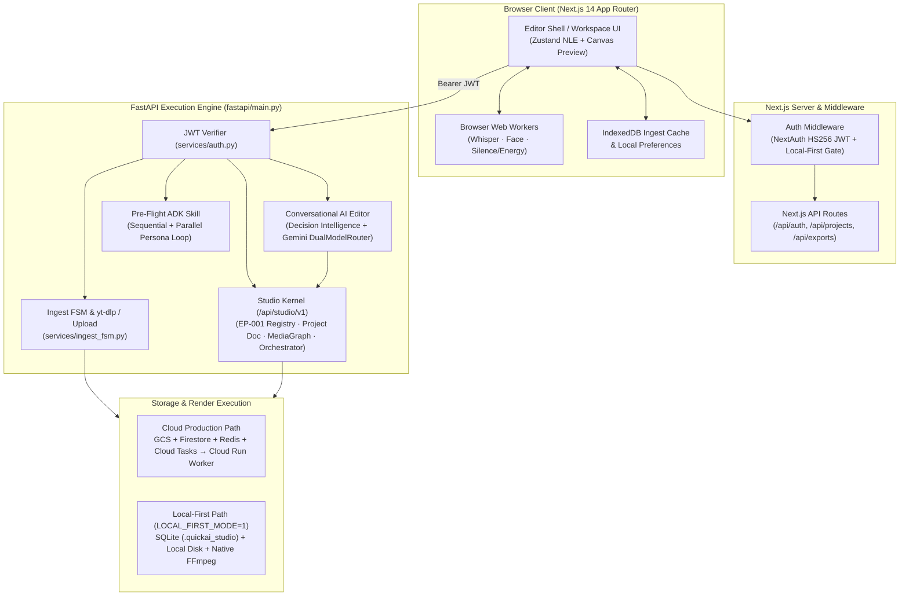
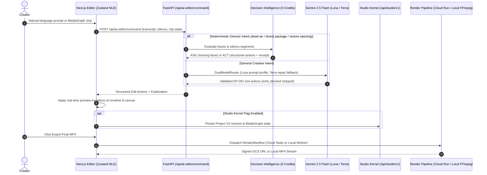

# Architecture — QuickAI Studio

**Last updated:** 2026-10-26  
**Stack (verified):** Next.js 14.2.35 · FastAPI · Gemini 2.5 Flash · Google ADK (Pre-Flight agents) · Cloud Tasks · Redis · ffmpeg-python · GCS primary (SQLite + local filesystem in `LOCAL_FIRST_MODE`) · NextAuth JWT

Canonical deep docs: [`docs/studio/`](docs/studio/README.md)  
Binding OS direction: [`docs/studio/PHASE2_ARCHITECTURAL_TRUTH_REVIEW.md`](docs/studio/PHASE2_ARCHITECTURAL_TRUTH_REVIEW.md)  
Live ops memory: [`CLAUDE.md`](CLAUDE.md) (WORKING MEMORY)

---

## Product identity & lineage

- **QuickAI Studio** is the evolution of QuickAI Short into an AI-native creative execution platform: a conversational video editor (ingest → chat → preview → export) backed by a structured Studio Kernel (Capability Registry + Project Document + MediaGraph + Orchestrator).
- Internal infrastructure identifiers (`quickai-api`, `quickai-worker`, `quickaishort-agent-494304-media`, `quickaishort` database names) are preserved for operational continuity.

---

## System topology



---

## Conversational edit execution flow



**Suggestions:** MediaGraph-grounded only (ADR-009). Heuristic-only chip lists are retired.

---

## Media ingest lifecycle (M2/M3)

Canonical FSM (FE runtime + BE contract in `services/ingest_fsm.py`):

```text
identify → validate → acquire_meta → projectize → analyze → ready | failed
```

- Hook: `frontend/src/hooks/useIngestLifecycle.ts` — **only** Studio ingest entry.
- Re-analysis: `ready|failed → analyze` via `retryAnalyze` (no duplicate Gemini on cache hit).
- Artifacts: IndexedDB (`ingestArtifacts.ts`); URL session restore via `sessionStorage` (no extra cloud).
- GCS file upload owned by lifecycle; pipeline must not double-PUT.

---

## Pre-Flight (ADK skill — not sole product identity)

Backend topology (agents live in `fastapi/agent/`):

```text
SequentialAgent (PreFlight Orchestrator)
  ├─ ClipCandidate · TrendGrounding · AnalyticsGrounding
  └─ LoopAgent (AudiencePanelLoop)
        ├─ ParallelAgent × 6 personas
        ├─ VoteAggregator
        ├─ QualityGate
        └─ ClipRefinement
```

Model: Gemini 2.5 Flash via `fastapi/services/gemini_client.py`. Luna is the ordered tool/JSON prompt profile; Terra is the single schema-repair profile. They are not external model providers. Redis blocks duplicate exact requests and shares bounded 429 cooldown state across instances.

**ADK workspace UI (`/adk`):** Coming Soon — blurred, intentionally unavailable until release (ADR-013 / EP-008). Do not document it as a live script-to-video studio.

---

## Storage & runtime modes

| Store / Mode | Cloud Production Role | Local-First Role (`LOCAL_FIRST_MODE=1`) |
|--------------|-----------------------|-----------------------------------------|
| **Primary Media** | **GCS** (`quickaishort-agent-494304-media`) — uploads, exports, TTS cache | `.quickai_studio/storage/` local filesystem |
| **Project & Kernel State** | **Firestore** — Studio Kernel project docs, user stats, ADK state | **SQLite** (`.quickai_studio/data/quickai_studio.db`) |
| **Auth & Job History** | **MongoDB** — NextAuth users, export history, legacy GridFS (`/api/v1/video/*`) | Explicit `LOCAL_FIRST_DEV_NO_AUTH=1` local session + SQLite |
| **Coordination & Cache** | **Redis** — render status, `runId` cancellation, locks/dedupe, Gemini 429 cooldown | In-memory cache & local process coordination |

Plan admission uses a fixed trusted-tier capability matrix (`fastapi/core/limits.py`):
Free = 720p + forced watermark + 500 MB storage + no deep analysis + `daily_ai_video_limit=3`; Pro unlocks 4K / no watermark / deep analysis / unlimited daily AI loops.

Historical notes that claimed "GridFS for all media" are obsolete. See ADR-002.

---

## Studio Kernel (shipped substrate)

| Package | Status |
|---------|--------|
| EP-001 Capability Registry ABI | **Frozen** |
| EP-002 Project Document | Implemented |
| EP-003 MediaGraph + suggestions | Implemented |
| EP-004 Orchestrator plan jobs | Implemented |
| EP-005 Chat-primary shell | Implemented |
| EP-006 Manifest bake from Kernel | Implemented |
| EP-007 Workflows / collab readiness | Design-locked (no multiplayer without approval) |
| EP-008 Editor first-run + ADK CS | Implemented |

Runtime surfaces (when flags on): `/api/studio/v1/projects`, `/media-graphs`, `/orchestrator`, ingest policy, onboarding.

Never bypass EP-001. Never invent a second tool ABI.

---

## Frontend workers

| Worker | Role |
|--------|------|
| `whisper.worker.ts` | In-browser transcription |
| `face.worker.ts` | MediaPipe face tracking |
| `analysis.worker.ts` | Silence / energy analysis |
| `_archive/workers/ffmpegExport.worker.ts` | **Quarantined** (orphan VideoWorkspace only) — not live `/editor`; never Final |

**Live client export:** WebCodecs (`ExportDialog`) + MediaRecorder fallback.  
**Final shareable MP4:** Cloud Tasks → private Cloud Run renderer → GCS (or native local FFmpeg in `LOCAL_FIRST_MODE`).

---

## Deployment

| Component | Platform |
|-----------|----------|
| Frontend | Vercel — `https://www.quickaishort.online` |
| API | Cloud Run `quickai-api` |
| Renderer | Private Cloud Run `quickai-worker` (`min=0`, request CPU, concurrency 1) |
| Durable dispatch | Cloud Tasks `quickai-render` (OIDC, 3 bounded attempts) |

Cost policy: API and renderer both scale to zero; Redis is no longer a compute wake path.

---

## Authority order (for agents and humans)

1. Phase 2 Architectural Truth Review  
2. Accepted ADRs + frozen EP-001 + Canonical Project Memory  
3. `docs/studio/` subsystem docs  
4. `CLAUDE.md` WORKING MEMORY (ops)  
5. This file + root README (must not contradict 1–2)

---

## Related

- [`docs/studio/03-architecture.md`](docs/studio/03-architecture.md)  
- [`docs/studio/22-component-diagrams.md`](docs/studio/22-component-diagrams.md)  
- [`docs/studio/23-sequence-diagrams.md`](docs/studio/23-sequence-diagrams.md)  
- [`docs/studio/adrs/`](docs/studio/adrs/)  
