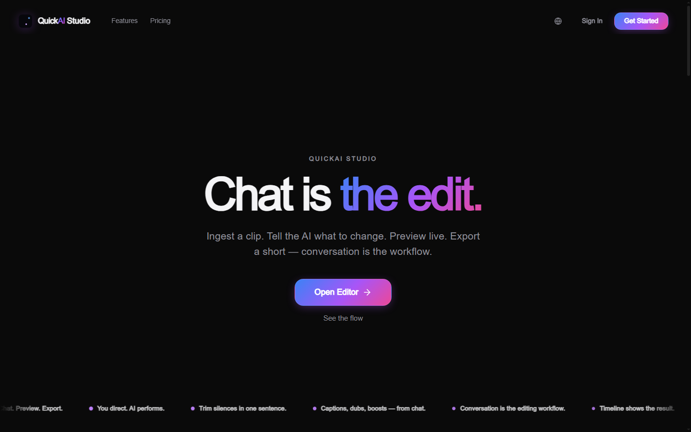
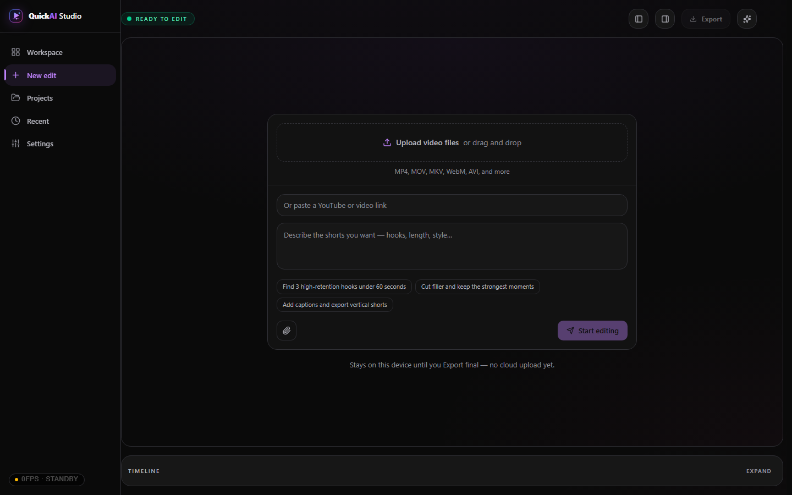
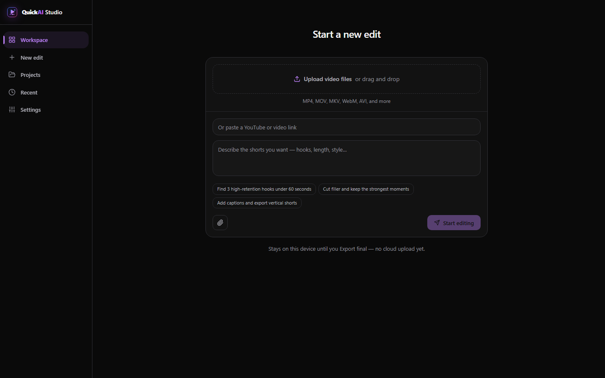
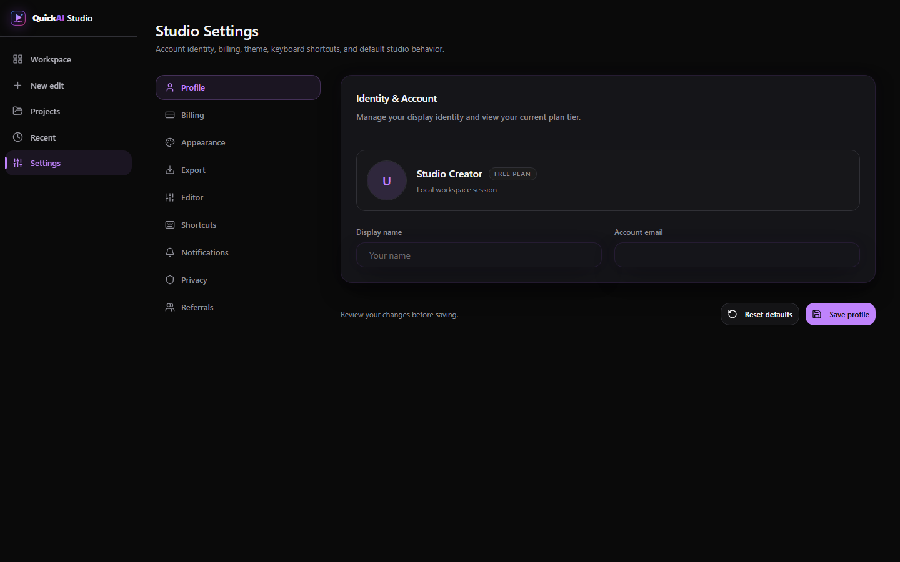
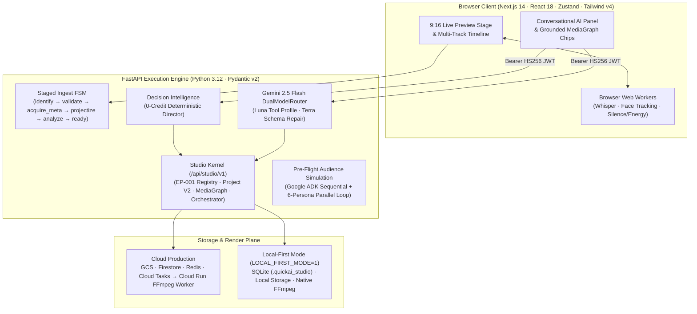
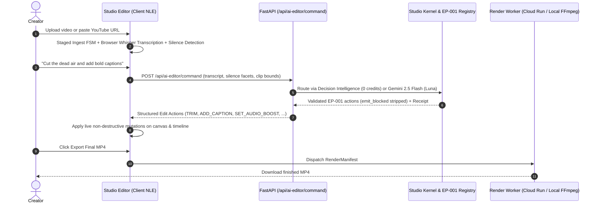

<div align="center">

<br />

<h1>QuickAI Studio</h1>
<p><strong>Conversational AI video editing — from long-form footage to finished short.</strong></p>

<p>
  <a href="https://www.quickaishort.online"></a>
  &nbsp;
  <a href="https://github.com/HassaanFisky/quickaishort/actions/workflows/linter.yml"></a>
  &nbsp;
  <a href="https://ai.google.dev/"></a>
  &nbsp;
  <a href="https://google.github.io/adk-docs/"></a>
  &nbsp;
  <a href="LICENSE"></a>
</p>

<p>
  <a href="https://www.quickaishort.online"><strong>Live Product</strong></a> ·
  <a href="docs/studio/README.md"><strong>Studio Docs</strong></a> ·
  <a href="ARCHITECTURE.md"><strong>Architecture</strong></a> ·
  <a href="QUICKSTART.md"><strong>Quickstart</strong></a> ·
  <a href="VISION.md"><strong>Vision</strong></a> ·
  <a href="CONTRIBUTING.md"><strong>Contributing</strong></a>
</p>

<br />

</div>

---

## Overview

**QuickAI Studio** (evolved from QuickAI Short) is a conversational AI video editing platform built for creators, podcasters, educators, and media teams.

Instead of manually scrubbing hours of raw footage in a traditional timeline editor, you paste a YouTube URL or drop a local video file, describe the edits you want in plain language, preview every mutation live on a 9:16 stage, and export a finished MP4.

- **Conversation is the control plane**: Natural-language prompts map to a frozen, schema-validated tool ABI (`EP-001`) — trim dead air, burn timed captions, reframe subjects, boost audio, apply visual filters, or dub speech.
- **Zero-spend Decision Intelligence**: Deterministic director intents (dead-air removal, shorts packaging, opening restoration) execute through the Studio Kernel with `0` Gemini API calls and `0` credit cost.
- **Grounded MediaGraph suggestions**: Suggestion chips are synthesized directly from your clip's transcript, silence segments, and energy facets (`ADR-009`) — never static placeholder lists.
- **Dual execution modes**: Run in cloud production with Google Cloud Storage, Firestore, Redis, and Cloud Tasks/Cloud Run workers, or run 100% locally on your machine via `LOCAL_FIRST_MODE=1` (embedded SQLite, local filesystem storage, native FFmpeg, and zero-spend `MOCK_AI_MODE`).

---

## Product Tour

| Landing (`https://quickaishort.online`) | Conversational Editor (`/editor`) |
|:---:|:---:|
|  |  |
| **Workspace Composer (`/dashboard`)** | **Studio Settings (`/settings`)** |
|  |  |

---

## System Architecture



### Conversational Edit Execution Workflow



Canonical architecture references: [`ARCHITECTURE.md`](ARCHITECTURE.md) · [`docs/studio/README.md`](docs/studio/README.md) · [`docs/studio/PHASE2_ARCHITECTURAL_TRUTH_REVIEW.md`](docs/studio/PHASE2_ARCHITECTURAL_TRUTH_REVIEW.md) · [`docs/studio/CANONICAL_PROJECT_MEMORY.md`](docs/studio/CANONICAL_PROJECT_MEMORY.md)

---

## Capability Matrix

| Capability | Status | Execution Surface | Notes |
| :--- | :--- | :--- | :--- |
| **Staged Media Ingest FSM** | **Production** | Browser + FastAPI (`services/ingest_fsm.py`) | Canonical `identify → validate → acquire_meta → projectize → analyze → ready\|failed` lifecycle with IndexedDB artifact caching. |
| **In-Browser Transcription & Analysis** | **Production** | Web Workers (`whisper.worker.ts`, `analysis.worker.ts`, `face.worker.ts`) | On-device Whisper speech-to-text, RMS silence/energy detection, and MediaPipe face tracking. |
| **Conversational AI Editor (`EP-001`)** | **Production** | `POST /api/ai-editor/command` | Dual-path router: zero-credit Decision Intelligence for director intents + Gemini 2.5 Flash (`Luna`/`Terra`) for open-ended edits. |
| **Studio Kernel (`EP-001`–`EP-006`)** | **Production** | `/api/studio/v1/projects`, `/media-graphs`, `/orchestrator` | Frozen capability registry (`EP-001`), Project V2 document, MediaGraph-grounded suggestions, and orchestrator plan execution. |
| **Client & Server Video Export** | **Production** | WebCodecs + Cloud Tasks / `render_worker.py` | Instant browser preview export or server-side FFmpeg render to GCS signed URLs (or local disk in `LOCAL_FIRST_MODE`). |
| **Pre-Flight Multi-Agent Simulation** | **Production (Skill)** | `fastapi/agent/` (Google ADK) | 6-persona audience panel loop with trend and analytics grounding; invoked as a validation skill. |
| **Windows / Desktop Local-First Mode** | **Production** | `LOCAL_FIRST_MODE=1` | Embedded SQLite + local disk storage + optional local Ollama/FFmpeg with zero cloud dependencies. |
| **ADK Standalone Workspace UI (`/adk`)** | **Roadmap (Coming Soon)** | `frontend/src/app/(dashboard)/adk/` | Intentionally gated as Coming Soon (`ADR-013` / `EP-008`) until multi-agent storyboard generation ships. |
| **Multiplayer Collaboration** | **Roadmap (Design-Locked)** | `EP-007` | Revision-safe schema hooks exist; real-time multiplayer is deferred. |

---

## Quickstart

### Option A — Local-First Mode (Zero Cloud / Zero Docker / Zero API Spend)

Run the entire QuickAI Studio stack locally using embedded SQLite and schema-valid mock AI fixtures:

**1. Start the FastAPI Backend**

```powershell
cd fastapi
python -m venv venv
.\venv\Scripts\Activate.ps1
pip install -r requirements.txt

$env:LOCAL_FIRST_MODE = "1"
$env:MOCK_AI_MODE = "1"
$env:ENVIRONMENT = "staging"
$env:NEXTAUTH_SECRET = "local_studio_test_secret_32_characters_minimum_999"
uvicorn main:app --host 127.0.0.1 --port 8000 --reload
```

**2. Start the Next.js Frontend**

```powershell
cd frontend
pnpm install

$env:NEXT_PUBLIC_LOCAL_FIRST_MODE = "1"
$env:LOCAL_FIRST_MODE = "1"
$env:LOCAL_FIRST_DEV_NO_AUTH = "1"
$env:NEXT_PUBLIC_STUDIO_PROJECT_KERNEL = "1"
$env:NEXT_PUBLIC_API_URL = "http://127.0.0.1:8000"
$env:NEXTAUTH_SECRET = "local_studio_test_secret_32_characters_minimum_999"
$env:NEXTAUTH_URL = "http://localhost:3000"
pnpm dev
```

Open `http://localhost:3000` (or run `./start-studio.ps1` on Windows to launch both services automatically).

### Option B — Full Cloud-Backed Development

See [`QUICKSTART.md`](QUICKSTART.md) for configuring MongoDB, Redis, Google Cloud Storage, and live Gemini API keys using `frontend/.env.example` and `fastapi/.env.example`.

---

## Configuration & Environment Reference

| Variable | Surface | Required | Description |
| :--- | :--- | :---: | :--- |
| `NEXTAUTH_SECRET` | Frontend & Backend | **Yes** | Shared HS256 secret (≥32 chars) used to sign NextAuth sessions and verify backend Bearer JWTs. Must match identically in both services. |
| `NEXT_PUBLIC_API_URL` | Frontend | **Yes** | Base URL of the FastAPI backend (e.g., `http://127.0.0.1:8000`). |
| `GEMINI_API_KEY` | Backend | Cloud / Live AI | Google Gemini API key for conversational editing (`gemini-2.5-flash`) and Pre-Flight agents. Not required when `MOCK_AI_MODE=1`. |
| `LOCAL_FIRST_MODE` | Frontend & Backend | Optional (`0`/`1`) | Enables embedded SQLite (`.quickai_studio/data/quickai_studio.db`), local media storage (`.quickai_studio/storage/`), and in-memory job coordination. |
| `LOCAL_FIRST_DEV_NO_AUTH` | Frontend | Optional (`0`/`1`) | Explicitly permits unauthenticated local workspace access on loopback (`localhost`/`127.0.0.1`) when `NODE_ENV !== "production"` and `LOCAL_FIRST_MODE=1`. |
| `MOCK_AI_MODE` | Backend | Optional (`true`/`1`) | Returns deterministic, schema-valid `EP-001` edit fixtures with zero Gemini token spend (blocked in `ENVIRONMENT=production`). |
| `MONGODB_URI` | Frontend & Backend | Cloud Mode | MongoDB connection string for NextAuth accounts and export history (`mongodb://127.0.0.1:27017/quickaishort`). |
| `REDIS_URL` | Backend & Worker | Cloud Mode | Redis connection URL (`redis://localhost:6379`) for render job status, `runId` cancellation, and Gemini 429 cooldown coordination. |
| `GCS_BUCKET_NAME` | Backend & Worker | Cloud Mode | Primary Google Cloud Storage bucket for media uploads, rendered exports, and TTS cache. |

---

## Testing & Verification

```bash
# 1. Verify frozen EP-001 capability registry synchronization
python fastapi/scripts/check_registry_sync.py

# 2. Run Backend Test Suite (pytest)
cd fastapi
pytest

# 3. Run Frontend Lint, Typecheck, Security & Accessibility Verification, and Production Build
cd frontend
pnpm lint
npx tsc --noEmit
node scripts/verify_middleware.mjs
node scripts/test_middleware_adversarial.mjs
node scripts/verify_navbar_focus.mjs
pnpm build
```

---

## Repository Structure

```text
quickaishort/
├── frontend/                 # Next.js 14 App Router — Editor, Workspace, AI Panel, Studio client
│   ├── public/               # Brand assets (studio-logo.svg, manifest.json, sw.js)
│   ├── scripts/              # Middleware security & accessibility verification suites
│   └── src/                  # Components, hooks, Zustand stores, Web Workers, Next.js API routes
├── fastapi/                  # FastAPI backend — AI Editor, Studio Kernel, Ingest FSM, Render Worker
│   ├── agent/                # Google ADK Pre-Flight multi-agent simulation pipeline
│   ├── capabilities/         # Frozen EP-001 Capability Registry ABI (registry.v1.json, schema.v1.json)
│   ├── routers/              # Studio Kernel v1 & Dubbing routers
│   ├── services/             # Auth, Gemini router, Decision Intelligence, Ingest FSM, Local Storage/DB
│   └── tests/                # Pytest unit, contract, security, and integration suites
├── docs/
│   ├── assets/screenshots/   # Verified product screenshots
│   ├── legal/                # Privacy Policy, Terms of Service, Refund Policy
│   └── studio/               # Canonical architecture specs, ADRs, and Execution Packages (EP-001..008)
├── extension/                # Chrome MV3 extension — send YouTube videos directly to QuickAI Studio
├── desktop/                  # Electron desktop wrapper for local-first studio execution
├── ARCHITECTURE.md           # System topology, sequence diagrams, and storage truth
├── QUICKSTART.md             # Local-first and cloud-backed setup instructions
├── SECURITY.md               # Security controls and vulnerability disclosure policy
└── VISION.md                 # Product lineage and Studio OS direction
```

---

## Contributing & License

- Please read [`CONTRIBUTING.md`](CONTRIBUTING.md) before opening a pull request.
- Security vulnerabilities should be reported privately per [`SECURITY.md`](SECURITY.md).
- Licensed under the [MIT License](LICENSE).

<div align="center">
<sub>Built with Gemini 2.5 Flash &amp; Google ADK · <a href="https://www.quickaishort.online">quickaishort.online</a></sub>
</div>
